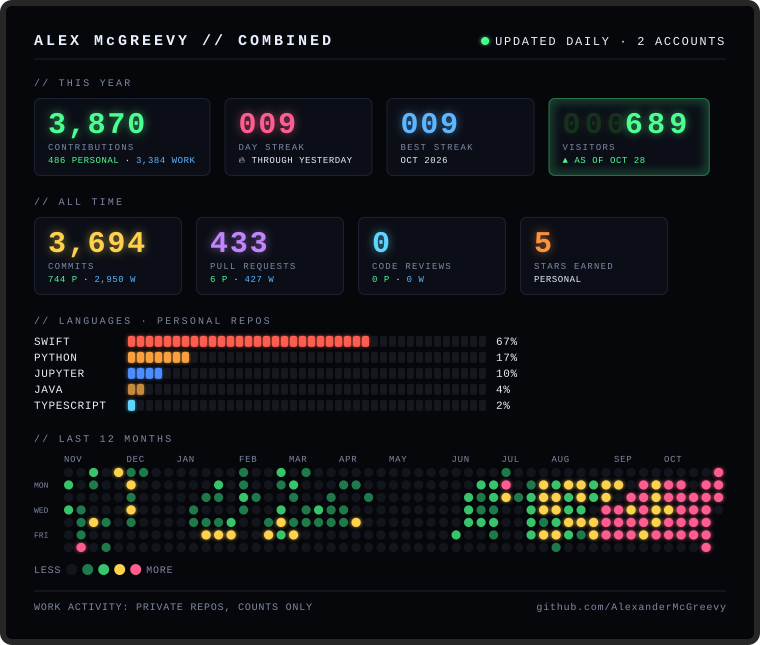

# 🌲 Alexander McGreevy  
Work account @ https://github.com/AlexanderMcGreevy1    <----- Currently my more active account(SWE @ The Waterside Group)
> 🧑‍💻 CS + SWE @ Northeastern | 🤺 Fencer | 🏕️ Outdoor Leader | 🚀 Aspiring SWE  

---

## 🚀 About Me  

- 🎓 **CS Student** @ Northeastern University — Concentration in Software Engineering  
- 💻 **10x Hackathon Participant(3x winner)** — HackMIT (🏆 3rd place Infosys Carbon-Conscious AI)
- 🧠 **Academic Interests:** Algorithms, Software Systems, AI/ML, and Sustainable Computing  
- 🛠️ **Builder at Heart:** Projects in Full-Stack, iOS (SwiftUI), and Chrome Extensions  
- 🤺 **Fencer & Coach** — Experienced in strategy, leadership, and mentoring  
- 🏕️ **Outdoor Leader** — Lead backpacking and wilderness programs during summers  

---

## ⚙️ Tech Stack

### Languages  

### Frameworks  

### Dev Tools  

### Libraries  

---

## 🪵 Featured Projects  

- 🌱 **EcoPrompt** — Chrome extension to track & cut AI token waste  
  *🏆 3rd Place @ HackMIT Infosys Carbon-Conscious AI Track*
- 🔒 **Obscurafy** — iOS app that detects and blurs or deletes sensitive info in your photo library  
  *🏆 Winner @ HackUMass Data Privacy Track*
- 🧠 **LookSmith** — Accessible 3D modeling app powered by facial tracking, built in Godot
- 💼 **CARDinal** — Digital business card iOS app for sharing contacts/resume easily 
- 🐾 **PetVitals** — iOS app for pet health & vet visit tracking  
- 🌳 **GoFundTree** — AR web-app for urban tree planting engagement  
- 🪐 **Clast** — Productivity IOS app that performs productivity analysis to enable breaks, enforces focus sessions, and blocks distractions
- 🎮 **Tetris Clone** — Recreation of the classic game in Java Swing

---

## 📈 GitHub Stats  

<picture>
  <source media="(max-width: 600px)" srcset="assets/scoreboard-narrow.svg">
  
</picture>

---

## 🌐 Let's Connect  

