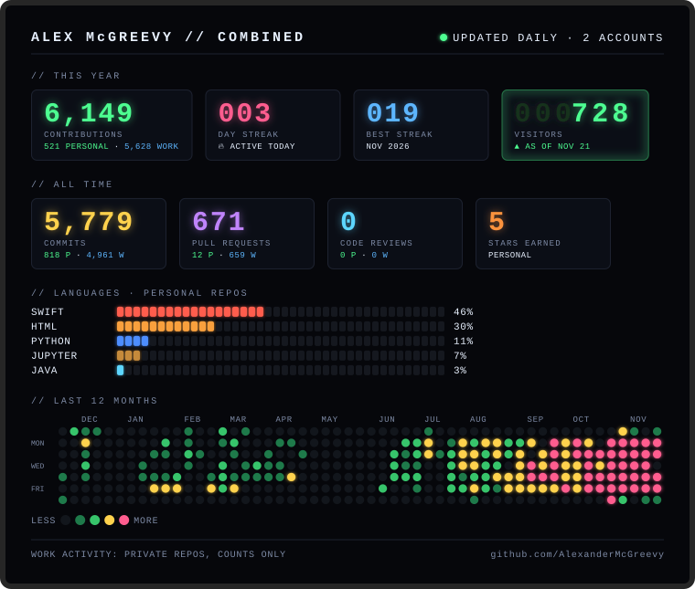

# 🌲 Alexander McGreevy  
> 🧑‍💻 CS + SWE @ Northeastern | 💼 SWE Co-op @ Waterside Group | 🤺 Fencer | 🏕️ Outdoor Leader  

Most of my 2026 work lives in private Waterside Group repos under my work account, [AlexanderMcGreevy1](https://github.com/AlexanderMcGreevy1). The stats further down combine both accounts.

---

## 🚀 About Me  

- 🎓 **CS Student** @ Northeastern University — Concentration in Software Engineering  
- 💼 **Software Engineering Co-op** @ Waterside Group (Jul – Dec 2026) — three public websites, a reusable CMS package, and features in the internal company portal  
- 🏦 **Software Engineering Intern** @ The Clearing House (Summer 2025) — rebuilt a payments simulation frontend in React on AWS  
- 💻 **11 hackathons, 3 wins** — including HackUMass XI (🏆 Best Data Protection) and HackMIT 2025 (🏆 3rd place, Infosys Carbon-Conscious AI)
- 🧠 **Academic Interests:** Algorithms, Software Systems, AI/ML, and Sustainable Computing  
- 🛠️ **Builder at Heart:** Projects in Full-Stack, iOS (SwiftUI), and Chrome Extensions  
- 🤺 **Fencer & Coach** — Experienced in strategy, leadership, and mentoring  
- 🏕️ **Outdoor Leader** — Lead backpacking and wilderness programs during summers  

---

## ⚙️ Tech Stack

### Languages  

### Frameworks  

### Dev Tools  

### Libraries  

---

## 🪵 Featured Projects  

**At work (private repos)**

- ⚓ **Flying Bridge Marina** — a boat dealer's new website and the custom CMS behind it, with "Tucker", a Claude-powered site assistant
- 🧱 **cms-kit** — that CMS extracted into a versioned package with a CLI; it now runs the Harbor Lights and South Peak sites
- 📚 **Document Archive** — the company's versioned document library and editor, searchable by AI (RAG over 1,000+ files)

**Hackathons and side projects**

- 🔒 **[Obscurafy](https://github.com/AlexanderMcGreevy/Obscurafy)** — iOS app that finds IDs and cards in your photo library, on-device  
  *🏆 Winner @ HackUMass XI, Best Data Protection*
- 🌱 **[EcoPrompt](https://github.com/AlexanderMcGreevy/EcoPrompt-Extension)** — Chrome extension that shows the CO₂ of every AI prompt and trims token waste  
  *🏆 3rd Place @ HackMIT 2025, Infosys Carbon-Conscious AI Track*
- 🚴 **[Whoosh](https://github.com/matte-realize/whoosh)** — rear-camera cycling safety: on-device YOLO, Apple Watch alerts, opt-in crash response  
  *Launch lead @ Hackachusetts 2026*
- 🪐 **Clast** — iOS app that blocks distracting apps until AI verifies your progress, with a planet collection for motivation
- 📡 **BLE Scanner** — personal iPhone app for decoding the Bluetooth devices around the house
- 🧠 **[LookSmith](https://github.com/Vegito2367/LookSmith)** — accessible 3D modeling driven by head and facial gestures (HackHarvard 2025)
- 🐾 **[PetVitals](https://github.com/AlexanderMcGreevy/PetAid)** — AI vet assistant, vet finder and food tracker for iOS (HackPSU Spring 2025)
- 🌳 **[GoFundTree](https://github.com/matt2jog/GoFundTree)** — AR web app for picturing and funding urban trees (HackPSU Fall 2024)
- 💼 **[CARDinal](https://github.com/AlexanderMcGreevy/CARDinal)** — swap digital business cards and resumes phone to phone
- 🎬 **[Moovie](https://github.com/AlexanderMcGreevy/Moovie)** — rank movies against each other and compare lists with friends
- 🎮 **[Tetris](https://github.com/AlexanderMcGreevy/Tetris)** — the classic, from scratch in Java Swing
- 🏔️ **[The Climb](https://github.com/AlexanderMcGreevy/portfolio-site)** — my portfolio, a site you scroll up a mountain

---

## 📈 GitHub Stats  

<picture>
  <source media="(max-width: 600px)" srcset="assets/scoreboard-narrow.svg">
  
</picture>

---

## 🌐 Let's Connect  

